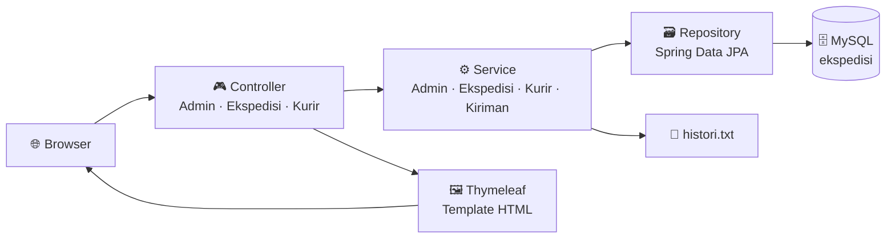
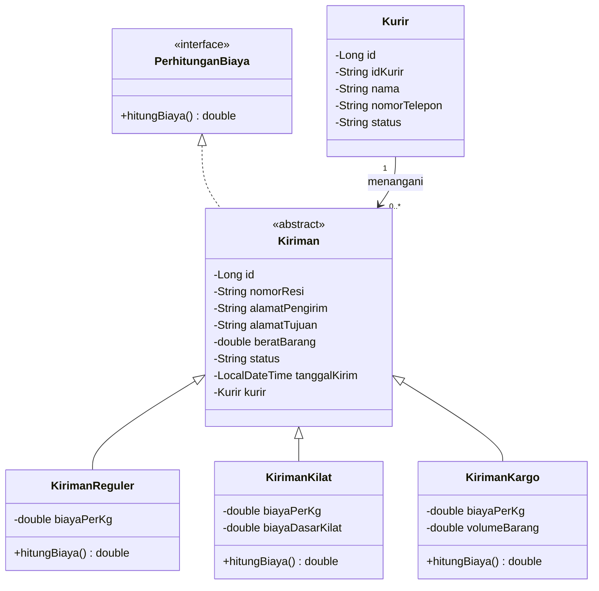

<div align="center">

# 🚚 Sistem Ekspedisi Barang

**Aplikasi web manajemen pengiriman barang: kelola kurir, hitung ongkir otomatis, dan catat setiap transaksi.**


[Fitur](#-fitur-utama) • [Perhitungan Biaya](#-perhitungan-biaya-pengiriman) • [Memulai](#-memulai-proyek) • [Arsitektur](#-arsitektur-aplikasi) • [Endpoint](#-daftar-endpoint) • [Struktur](#-struktur-direktori) • [Roadmap](#-catatan-dan-rencana-pengembangan)

</div>

---

## 📖 Tentang Proyek

**Sistem Ekspedisi Barang** adalah aplikasi manajemen pengiriman berbasis web yang dibangun dengan **Spring Boot** dan arsitektur **MVC**. Admin dapat mengelola data kurir, membuat kiriman dengan tiga kategori layanan, menugaskan kurir, dan memantau seluruh pengiriman dari satu dashboard. Ongkos kirim dihitung otomatis lewat penerapan **pewarisan (inheritance)** dan **polimorfisme** pada kelas `Kiriman`.

## ✨ Fitur Utama

### 🔐 Autentikasi Admin
* Halaman login khusus admin dengan manajemen sesi.
* Dashboard dan proses kiriman dijaga pengecekan sesi. Pengguna yang belum login diarahkan ke halaman login.
* Logout menghapus sesi sepenuhnya.

### 📦 Manajemen Kiriman
* **Tambah, ubah, dan hapus** data kiriman dari satu halaman dashboard.
* **Tiga kategori layanan:** Reguler, Kilat, dan Kargo.
* **Data lengkap:** nomor resi unik, alamat pengirim, alamat tujuan, berat barang, status (bawaan `Diproses`), dan tanggal kirim otomatis.
* **Penugasan kurir:** pilih kurir langsung dari form kiriman, atau biarkan *Belum Ditugaskan*.
* **Ongkir otomatis:** biaya dihitung dan ditampilkan per baris pada tabel dengan format ribuan.
* **Validasi bisnis:** alamat pengirim wajib diisi, tipe kiriman harus valid, dan Kargo minimal 10 kg. Pesan galat ditampilkan di dashboard tanpa kehilangan data tabel.

### 🧑‍✈️ Manajemen Kurir
* **CRUD kurir** pada halaman khusus.
* **ID kurir otomatis** berformat `KR-XXXXX` (contoh: `KR-04821`).
* **Status kurir:** `Aktif` atau `Cuti`.
* Data kurir: nama dan nomor telepon.

### 📝 Pencatatan Riwayat
* Setiap kiriman yang disimpan otomatis ditulis ke berkas **`histori.txt`** lengkap dengan waktu, resi, tipe, tujuan, berat, dan biaya.

## 💰 Perhitungan Biaya Pengiriman

Setiap tipe kiriman adalah subclass dari `Kiriman` yang mengimplementasikan interface `PerhitunganBiaya`, sehingga metode `hitungBiaya()` berperilaku berbeda sesuai tipenya.

| Tipe | Rumus | Tarif Saat Ini | Syarat |
| :--- | :--- | :--- | :--- |
| 🟦 **Reguler** | `berat × tarif per kg` | Rp 8.000 / kg | - |
| 🟧 **Kilat** | `(berat × tarif per kg) + biaya dasar` | Rp 5.000 / kg + Rp 20.000 | - |
| 🟪 **Kargo** | `berat × tarif per kg` | Rp 10.000 / kg | Berat minimal **10 kg**, volume opsional (disimpan, belum memengaruhi biaya) |

**Contoh perhitungan:**

| Kasus | Perhitungan | Total |
| :--- | :--- | ---: |
| Reguler 5 kg | 5 × 8.000 | **Rp 40.000** |
| Kilat 2 kg | (2 × 5.000) + 20.000 | **Rp 30.000** |
| Kargo 10 kg | 10 × 10.000 | **Rp 100.000** |

## 🧰 Teknologi yang Digunakan

| Kategori | Teknologi |
| :--- | :--- |
| Bahasa | Java 17 |
| Framework | Spring Boot 3.5.7 (Web, Data JPA, Validation, DevTools) |
| Template Engine | Thymeleaf |
| ORM | Spring Data JPA (Hibernate) |
| Database | MySQL (utama), H2 (opsional untuk pengembangan) |
| Frontend | HTML5, CSS3, JavaScript, Font Awesome 6 |
| Build Tool | Maven (Maven Wrapper disertakan) |
| Utilitas | Lombok |

## 🚀 Memulai Proyek

### Prasyarat

Pastikan lingkungan pengembangan Anda telah terpasang dan dikonfigurasi dengan benar:
* [JDK 17](https://adoptium.net/) atau lebih baru
* [MySQL Server 8](https://dev.mysql.com/downloads/) (atau XAMPP / Laragon)
* Editor teks atau IDE (IntelliJ IDEA / VS Code / Eclipse)
* Maven tidak perlu dipasang terpisah karena proyek sudah menyertakan `mvnw`

### Instalasi dan Eksekusi

1. Kloning repositori dan masuk ke direktori aplikasi.
```bash
   git clone https://github.com/darrenevann/SistemEkspedisiBarang.git
   cd SistemEkspedisiBarang/demospringboot
```
2. Buat database kosong bernama `ekspedisi` di MySQL.
```sql
   CREATE DATABASE ekspedisi;
```
3. Sesuaikan koneksi database pada `src/main/resources/application.properties` bila berbeda.
```properties
   spring.datasource.url=jdbc:mysql://localhost:3306/ekspedisi?useSSL=false&serverTimezone=UTC
   spring.datasource.username=root
   spring.datasource.password=
```
4. Jalankan aplikasi. Tabel `admin`, `kurir`, dan `kiriman` dibuat otomatis oleh Hibernate (`ddl-auto=update`).
```bash
   # Linux / macOS
   ./mvnw spring-boot:run

   # Windows
   mvnw.cmd spring-boot:run
```
5. Tambahkan akun admin pertama. Aplikasi tidak menyediakan data admin awal, jadi jalankan perintah ini setelah aplikasi berjalan satu kali:
```sql
   USE ekspedisi;
   INSERT INTO admin (username, password, nama_lengkap, level)
   VALUES ('admin', 'admin123', 'Administrator', 'admin');
```
6. Buka peramban dan masuk.

| Halaman | URL |
| :--- | :--- |
| 🔐 Login Admin | `http://localhost:8081/admin/login` |
| 📊 Dashboard | `http://localhost:8081/admin/dashboard` |
| 🧑‍✈️ Manajemen Kurir | `http://localhost:8081/kurir/manage` |

> 💡 **Ingin memakai H2?** Blok konfigurasi H2 sudah tersedia (dikomentari) di `application.properties`. Aktifkan blok tersebut dan nonaktifkan blok MySQL.

## 🏗️ Arsitektur Aplikasi

Aplikasi memakai pola **MVC berlapis**: Controller menerima request, Service menjalankan logika bisnis, Repository mengakses database.



### Hierarki Kelas Kiriman



### Strategi Database

Ketiga subclass disimpan dalam **satu tabel `kiriman`** (`InheritanceType.SINGLE_TABLE`). Kolom pembeda `tipe_kiriman` bernilai `Reguler`, `Kilat`, atau `Kargo`.

| Tabel | Kolom Penting |
| :--- | :--- |
| `admin` | `id`, `username`, `password`, `nama_lengkap`, `level` |
| `kurir` | `id`, `id_kurir_sistem` (unik), `nama`, `nomor_telepon`, `status` |
| `kiriman` | `id`, `nomor_resi` (unik), `alamat_pengirim`, `alamat_tujuan`, `berat_barang`, `status`, `tanggal_kirim`, `kurir_id` (FK), `tipe_kiriman`, `biaya_per_kg`, `biaya_dasar_kilat`, `volume_barang` |

## 🧭 Daftar Endpoint

| Method | Endpoint | Fungsi |
| :---: | :--- | :--- |
| `GET` | `/admin/login` | Menampilkan halaman login |
| `POST` | `/admin/login` | Memproses login dan membuat sesi |
| `GET` | `/admin/dashboard` | Dashboard kiriman (perlu login) |
| `GET` | `/admin/logout` · `/logout` | Mengakhiri sesi |
| `POST` | `/kiriman` | Tambah atau ubah kiriman |
| `GET` | `/kiriman/edit?id={id}` | Memuat data kiriman ke form edit |
| `GET` | `/kiriman/delete?id={id}` | Menghapus kiriman |
| `GET` | `/kurir/manage` | Daftar kurir dan form |
| `POST` | `/kurir/save` | Tambah atau ubah kurir |
| `GET` | `/kurir/edit/{id}` | Memuat data kurir ke form edit |
| `GET` | `/kurir/delete/{id}` | Menghapus kurir |

## 📁 Struktur Direktori

```text
SistemEkspedisiBarang/
├── demospringboot/
│   ├── src/main/java/com/example/demospringboot/
│   │   ├── DemospringbootApplication.java   # Titik masuk aplikasi
│   │   ├── controller/
│   │   │   ├── AdminMvcController.java      # Login, dashboard, logout
│   │   │   ├── EkspedisiController.java     # Proses kiriman (tambah/ubah/hapus)
│   │   │   ├── KurirController.java         # CRUD kurir
│   │   │   └── LogoutController.java        # Logout global
│   │   ├── service/
│   │   │   ├── EkspedisiService.java        # Logika kiriman, tarif, dan pencatatan riwayat
│   │   │   ├── KirimanService.java          # Pengambilan data kiriman
│   │   │   ├── KurirService.java            # CRUD kurir dan pembuat ID otomatis
│   │   │   └── AdminService.java            # Verifikasi login
│   │   ├── repository/                      # Antarmuka Spring Data JPA
│   │   └── entity/
│   │       ├── Kiriman.java                 # Kelas abstrak induk
│   │       ├── KirimanReguler.java          # Subclass layanan reguler
│   │       ├── KirimanKilat.java            # Subclass layanan kilat
│   │       ├── KirimanKargo.java            # Subclass layanan kargo
│   │       ├── PerhitunganBiaya.java        # Interface hitung biaya
│   │       ├── Kurir.java · Admin.java · LoginRequest.java
│   ├── src/main/resources/
│   │   ├── templates/                       # admin_login · admin_dashboard · admin_kurir_manage
│   │   ├── static/css/ · static/js/         # Gaya dan skrip antarmuka
│   │   └── application.properties           # Konfigurasi server dan database
│   ├── src/test/                            # Direktori pengujian
│   ├── histori.txt                          # Log riwayat kiriman (dibuat otomatis)
│   ├── mvnw · mvnw.cmd · pom.xml            # Maven Wrapper dan dependensi
└── README.md
```

## 🛠️ Catatan dan Rencana Pengembangan

Proyek ini masih berupa prototipe akademik. Beberapa peningkatan yang direkomendasikan:

- [ ] Hash password dengan **BCrypt** (Spring Security) menggantikan perbandingan teks biasa
- [ ] Ubah aksi hapus dari `GET` menjadi `POST`/`DELETE` dengan proteksi CSRF
- [ ] Lindungi seluruh rute `/kurir/**` dengan pengecekan sesi seperti rute kiriman
- [ ] Tambahkan data awal admin lewat `data.sql` atau `CommandLineRunner`
- [ ] Pakai volume barang dalam perhitungan biaya Kargo
- [ ] Tambahkan fitur ubah status kiriman (`Diproses`, `Dikirim`, `Diterima`) dari antarmuka
- [ ] Pertahankan status kiriman saat proses edit (saat ini kembali ke `Diproses`)
- [ ] Halaman pelacakan resi untuk pelanggan
- [ ] Pindahkan tarif dari kode ke `application.properties` atau tabel database
- [ ] Lengkapi pengujian unit pada `EkspedisiService`
- [ ] Tambahkan `histori.txt` ke `.gitignore`

## 👥 Tim Pengembang

| Nama | NPM | Fokus Kontribusi |
| :--- | :--- | :--- |
| **Darren Evan Nathanael** | 825240062 | Entity `Kiriman` beserta subclass dan interface perhitungan biaya |
| **Leticia Michelle Purba** | 8252401440 | Controller, autentikasi admin, dan modul kurir |
